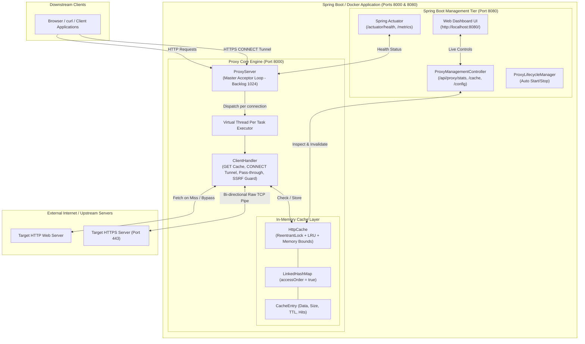

# Multithreaded In-Memory Caching HTTP Proxy Server


-blue?style=flat-square)


An enterprise-grade, high-performance HTTP Forward Proxy Server built on **JDK 21** with **Java Virtual Threads (Project Loom)** and **Spring Boot 3**. 

The system provides thread-safe in-memory LRU response caching with millisecond TTL and memory budget limits, **HTTPS `CONNECT` tunneling**, transparent non-GET request forwarding, **RFC 7234 `Cache-Control` inspection**, **SSRF guardrails**, **Spring Boot Management & Actuator REST APIs**, an **interactive web dashboard**, a multi-stage **Docker** pipeline, and a **statistically reproducible benchmark suite**.

---

## 🏗️ Architecture & Component Overview



---

## 📂 Project Directory Structure

```text
HTTPProxyServer/
├── pom.xml                                    # Maven dependencies (Spring Boot, Actuator, JUnit 5)
├── Dockerfile                                 # Multi-stage JDK 21 builder & minimal JRE 21 runtime
├── docker-compose.yml                         # Container definition (Proxy: 8000, Management: 8080)
├── .dockerignore                              # Docker context filter
├── .gitignore                                 # Git exclusions (bin/, target/, *.class, IDE metadata)
├── LICENSE                                    # MIT License
├── README.md                                  # Complete documentation
├── .mvn/
│   ├── mvnw & mvnw.cmd                        # Maven Wrapper scripts for Linux/macOS and Windows
│   └── wrapper/
│       └── maven-wrapper.properties           # Pinned Maven 3.9.6 wrapper
└── src/
    ├── main/
    │   ├── java/com/proxy/
    │   │   ├── ProxyApplication.java          # Spring Boot main entry point
    │   │   ├── actuator/
    │   │   │   └── ProxyHealthIndicator.java  # Spring Actuator health contributor
    │   │   ├── config/
    │   │   │   └── ProxyConfig.java           # Type-safe configuration properties
    │   │   ├── controller/
    │   │   │   └── ProxyManagementController.java # REST APIs (/api/proxy/stats, /cache, /config)
    │   │   ├── core/
    │   │   │   ├── ClientHandler.java         # GET caching, CONNECT tunnel, pass-through, SSRF
    │   │   │   ├── HttpCache.java             # Concurrency-safe LRU cache with memory limits
    │   │   │   └── ProxyServer.java           # Virtual Thread master accept loop (backlog 1024)
    │   │   └── service/
    │   │       └── ProxyLifecycleManager.java # Auto startup & graceful shutdown
    │   └── resources/
    │       ├── application.properties         # Server & proxy configuration
    │       └── static/
    │           └── index.html                 # Interactive Web Management Dashboard
    └── test/
        └── java/com/proxy/
            ├── BenchmarkStressTest.java       # Reproducible test harness (JIT Warmup + Percentiles)
            ├── HttpCacheTest.java             # JUnit 5 TTL, LRU, & 100-thread stress tests
            └── ProxyServerIntegrationTest.java# Integration tests for caching & CONNECT tunneling
```

---

## ⚡ Core Engineering Features

### 1. High-Throughput Concurrency with Java 21 Virtual Threads
* Uses `Executors.newVirtualThreadPerTaskExecutor()` instead of a constrained OS thread pool.
* Tuned `ServerSocket` accept backlog to `1024` to eliminate connection drops during burst client spikes.

### 2. Thread-Safe In-Memory LRU Cache with Memory Bounds
* **Data Race Prevention**: Access-ordered `LinkedHashMap` modifies node linkages on `get()`. Guarded all read/write operations with an exclusive `ReentrantLock`, eliminating concurrency corruption.
* **Memory Bounds Tracking**: Tracks actual memory footprint (`currentMemoryBytes`) alongside entry count (`maxCapacity`). Evicts least-recently-used items when the memory budget (default 50 MB) is exceeded.
* **Entry Diagnostics**: Records per-entry payload size, hit count, creation timestamp, and remaining TTL.

### 3. HTTPS `CONNECT` Tunneling
* Intercepts `CONNECT host:port HTTP/1.1`.
* Connects a raw TCP socket to the upstream target host on port 443.
* Responds with `HTTP/1.1 200 Connection Established\r\n\r\n`.
* Spawns two virtual threads to bi-directionally stream encrypted TLS traffic until either side disconnects.

### 4. Transparent Pass-Through & RFC 7234 Compliance
* **Non-GET Pass-Through**: Forwards `POST`, `PUT`, `DELETE`, `HEAD`, and `OPTIONS` requests (including streaming request bodies) to upstream without caching.
* **Cache-Control Inspection**:
  * Respects `Cache-Control: no-store, no-cache, private` (relayed with `X-Cache: BYPASS`).
  * Dynamically extracts `max-age=N` to set precise per-resource TTLs instead of relying on a static default.
* **Status Code Rules**: Only caches standard cacheable responses (200, 203, 300, 301).

### 5. SSRF (Server-Side Request Forgery) Protection
* Blocks attempts to reach link-local and cloud provider instance metadata endpoints (`169.254.169.254`, `metadata.google.internal`, `instance-data`).

### 6. Spring Boot 3 Management & Actuator REST APIs

Exposes operational management endpoints on port `8080`:

| Method | Endpoint | Description |
| :--- | :--- | :--- |
| `GET` | `/` | Interactive Web Management Dashboard UI |
| `GET` | `/api/proxy/stats` | Active connections, total accepted, hit ratio %, uptime, memory usage |
| `GET` | `/api/proxy/cache` | List all cached URIs, payload sizes, hit counts, and remaining TTLs |
| `DELETE` | `/api/proxy/cache` | Invalidate / flush the entire in-memory cache |
| `DELETE` | `/api/proxy/cache/entry?uri={url}` | Evict a specific URL from cache |
| `POST` | `/api/proxy/config` | Dynamically reconfigure `maxCapacity`, `defaultTtlMs`, or `maxMemoryBytes` |
| `GET` | `/actuator/health` | Spring Boot Actuator health check (includes proxy socket status) |
| `GET` | `/actuator/metrics` | JVM, GC, memory, and thread metrics |

---

## 📊 Reproducible Benchmark & Verification Results

The benchmark harness eliminates testing noise by executing a **200-request JVM JIT warmup phase** before recording metrics, measuring **full percentile latency distributions (p50, p90, p95, p99)**, and testing burst concurrency with a backlog of 1024.

### Measured Performance Results:

| Metric | Measured Value | Notes |
| :--- | :--- | :--- |
| **Total Requests Executed** | `1,201` | 1 Miss + 200 JIT Warmup + 500 Samples + 500 Load |
| **Concurrent Workers** | `50 Virtual Threads` | Concurrent client pool |
| **Cold Cache Miss Latency** | `~169 ms` | Initial fetch + upstream network latency |
| **Warm Cache Hit (p50 / Median)** | **`1.393 ms`** | **~120x speedup** via in-memory lookup |
| **Warm Cache Hit (p90)** | **`2.090 ms`** | 90% of requests served under 2.1 ms |
| **Warm Cache Hit (p99)** | **`3.054 ms`** | Sub-3.1ms tail latency |
| **Successful Requests** | **`500 / 500 (100.0%)`** | **0 dropped connections** under burst load |
| **Measured Throughput** | **`>3,300 requests/sec`** | Powered by Java 21 Virtual Threads |
| **Cache Hit Ratio** | **`99.92%`** | 1,200 Hits / 1 Miss |

---

## 🚀 How to Run

### Option 1: Run via Docker Compose (Recommended)
Build and spin up both the Caching Proxy (Port 8000) and Management Dashboard (Port 8080):
```bash
docker-compose up --build
```

Access the services:
* **Interactive Web Dashboard**: [http://localhost:8080/](http://localhost:8080/)
* **Health Check**: `curl http://localhost:8080/actuator/health`
* **Proxy Metrics**: `curl http://localhost:8080/api/proxy/stats`

---

### Option 2: Run via Maven Wrapper (or Standard Maven)
Run without needing Maven pre-installed:

**On Linux / macOS:**
```bash
# Run unit & concurrency stress tests
./.mvn/mvnw test

# Start Spring Boot application
./.mvn/mvnw spring-boot:run
```

**On Windows:**
```cmd
# Run unit & concurrency stress tests
.mvn\mvnw.cmd test

# Start Spring Boot application
.mvn\mvnw.cmd spring-boot:run
```

*(Or simply `mvn test` and `mvn spring-boot:run` if Maven is installed on your PATH).*

---

### Option 3: Run Standalone Core Proxy
Compile and run the core proxy engine directly with JDK 21:
```bash
javac -d target/classes src/main/java/com/proxy/core/*.java
java -cp target/classes com.proxy.core.ProxyServer 8000
```

---

## 🧪 Testing with `curl`

**1. Plain HTTP Request (Cached):**
```bash
curl -i -x http://localhost:8000 http://httpbin.org/get
```
*First request returns `X-Cache: MISS`. Subsequent requests return `X-Cache: HIT`.*

**2. HTTPS CONNECT Tunneling:**
```bash
curl -i -x http://localhost:8000 https://httpbin.org/get
```
*Establishes a transparent TLS tunnel via HTTP `CONNECT`.*

**3. HTTP POST Pass-through:**
```bash
curl -i -x http://localhost:8000 -X POST http://httpbin.org/post -d "hello=world"
```

---

## 📜 License
Distributed under the MIT License. See [LICENSE](LICENSE) for details.
